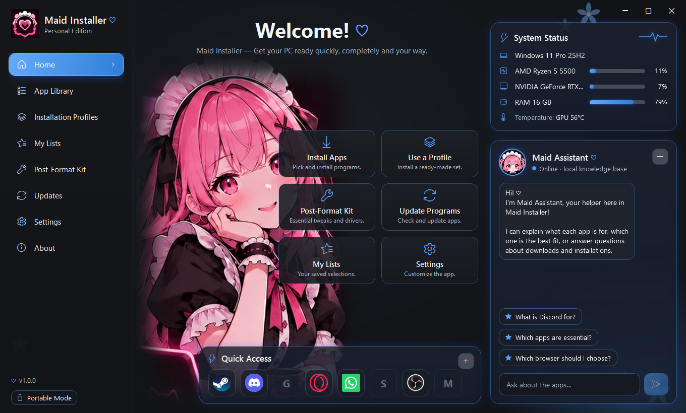
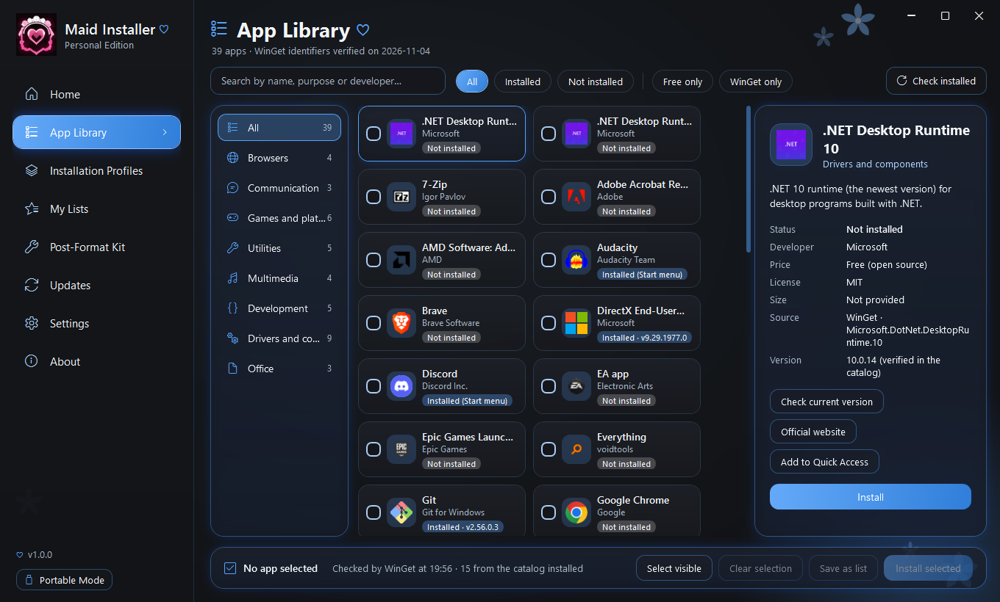
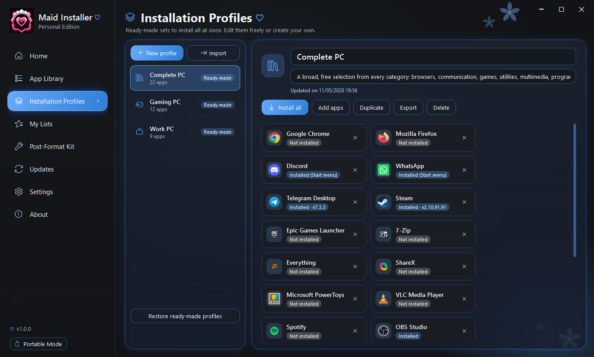
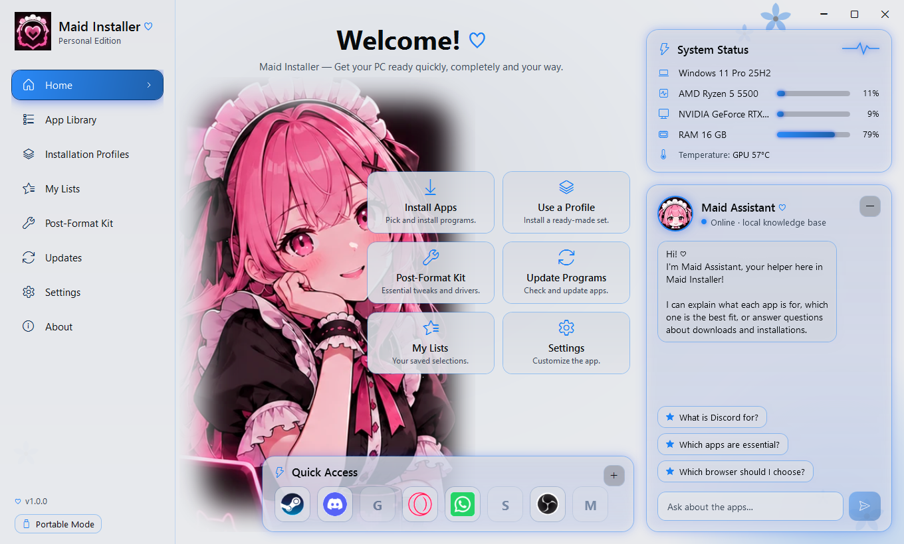
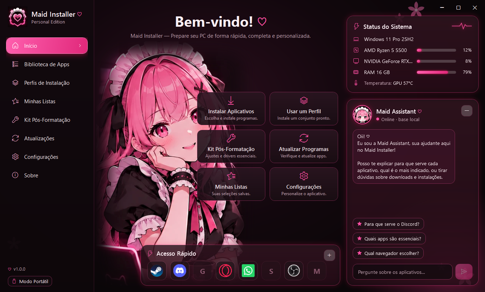

<div align="center">

# Maid Installer ♡

**Get your PC ready with care.**

Install, update and organize your programs after formatting Windows, in an app with the Maid mascot, three themes
(dark, light and black & pink) and an assistant that answers your questions. Available in English and Portuguese (Brazil).

[Português](README.md) · **English**

[](https://github.com/Maidzinha/maid-installer/releases/latest)


[](LICENSE.en.md)



</div>

## Download

Go to **[Releases → latest version](https://github.com/Maidzinha/maid-installer/releases/latest)** and pick one of the two packages:

| Package | When to use it |
|---|---|
| **`MaidInstaller-<version>-portatil-win-x64.zip`** | To carry on a **USB drive / Ventoy** and use right after formatting. Installs nothing on the PC |
| **`MaidInstaller-<version>-win-x64.zip`** | To keep it **installed on the PC**, with a Start menu shortcut |

Both include .NET, so they open on a freshly formatted Windows without installing anything first.

**Requirements:** Windows 10 (version 1809 or newer) or Windows 11, 64-bit. Installing programs requires **WinGet**, which comes
with Windows 11 and up-to-date Windows 10. If it is missing, the app tells you and shows where to get it.

## How to use

### Option 1: USB drive / Ventoy (portable)

1. Download `…-portatil-win-x64.zip` and extract it.
2. Copy the whole **`MaidInstaller`** folder to the USB drive. With Ventoy, it can sit at the root, next to the ISOs.
3. After formatting the PC, open **`MaidInstaller\MaidInstaller.exe`** straight from the USB drive.

In portable mode everything stays on the USB drive: settings, lists, profiles, logs and the AI.

### Option 2: install on the PC

1. Download `…-win-x64.zip` and extract **the whole file**.
2. Double-click **`Instalar.cmd`** and confirm.
3. Open **Maid Installer** from the Start menu.

The installer does not ask for administrator rights and does not touch the registry. Its messages follow the Windows language.
To update, run `Instalar.cmd` from the new version: your data stays. To uninstall, use `Desinstalar.ps1` in the program folder
(`%LocalAppData%\Programs\MaidInstaller`).

> **"Windows protected your PC"?** This SmartScreen warning appears because the app has no commercial digital signature.
> Click **More info → Run anyway**. To verify the download, compare the file's SHA-256 with the release's `SHA256SUMS.txt`.

### First steps

1. **App Library:** find the programs you want, tick them and click **Install selected**. Before anything starts, you see the exact list to confirm.
2. Or use a ready-made **Profile** (Gaming PC, Work PC, Complete PC) with **Install all**.
3. Run the **Post-Format Kit** checks: Windows Update, drivers, Visual C++ and DirectX, runtimes, temp files and power.
4. Not sure about a program? Ask **Maid Assistant** ("What is 7-Zip for?", "Which browser should I choose?").
5. Want another look or language? **Settings › Language and appearance**: English, Português (Brasil) or Automatic, and the Dark, Light or Black and pink theme.

Each screen is explained step by step in the **[User manual](docs/en/MANUAL.md)**.

<p align="center">
  
  
</p>

<p align="center">
  
  
</p>

## What it does

- **Library with 61 apps:** browsers, communication, games, utilities, multimedia, development, drivers and office. All with a verified WinGet ID, search, filters and real installation status.
- **Organized installation:** one program at a time, showing the real step. You can cancel, try again, see each app's log and read errors explained in plain language. When the queue finishes with the app in the background, a Windows notification shows the result.
- **Profiles and lists:** use the ready-made ones or create your own, and export or import `.maidlist.json` files.
- **Post-Format Kit:** 10 real system checks. The actions are optional and always ask for confirmation.
- **Updates:** shows what WinGet found and only updates what you choose.
- **Maid Assistant:** answers offline from a knowledge base. The local AI (Qwen2.5 0.5B, about 470 MB) is optional, can be downloaded from Settings and is limited to the facts in the base.
- **Welcome tour:** on first launch, Maid introduces the main screens in a few balloons.
- **System Status:** real CPU, GPU and RAM usage and the GPU temperature, when the PC allows it.
- **Two languages and three themes:** English and Portuguese (Brazil); Dark (default), Light and Black and pink.

## Safety

- Everything comes from **official sources**, through WinGet. The catalog only holds data, never commands.
- **Nothing is installed or updated without your confirmation.** The app **never restarts the PC**.
- The app does not disable your antivirus and does not store passwords.
- Maid Assistant **does not run, install or remove anything**: it only explains.

## Documentation

| | |
|---|---|
| [Installation](docs/en/INSTALL.md) | Requirements, portable, install, update, uninstall, default settings |
| [User manual](docs/en/MANUAL.md) | Every screen, Maid Assistant and common problems |
| [Version history](docs/en/CHANGELOG.md) | What changed in each version |
| Technical docs (Portuguese) | [Tests](docs/TESTES.md) · [Architecture](docs/ARQUITETURA.md) · [Roadmap](docs/ROADMAP.md) · [Updates](docs/ATUALIZACOES.md) · [Icons](docs/ICONES.md) |

## License

Maid Installer is **proprietary**, under a [private use license](LICENSE.en.md) (the [Portuguese original](LICENSE) is the binding version). All rights reserved.

- ✅ **You may:** download it from here, install and use it for free on as many PCs as you want, and share the official link.
- ❌ **You may not:**
  - modify the app or create derived versions of it;
  - present it as your own work;
  - redistribute copies outside this repository;
  - sell it;
  - use the name, the mascot or the look in other projects.

The code is visible for reference only, which does not grant permission to reuse it.
Third-party components (.NET, LLamaSharp, llama.cpp…) keep their own licenses: see [THIRD-PARTY-NOTICES.md](THIRD-PARTY-NOTICES.md).

## Building from source

Building is allowed for personal use only, without modifying the app (see the [license](LICENSE.en.md)). You need the [.NET SDK 10](https://dotnet.microsoft.com/download) on Windows.

```bash
git clone https://github.com/Maidzinha/maid-installer.git
```

```bash
cd maid-installer
```

```bash
dotnet run --project src/MaidInstaller.App
```

To run the tests:

```bash
dotnet test
```

To build the release packages, `build-release.ps1` runs the tests, publishes in Release and creates the `.zip` files, `SHA256SUMS.txt` and `release.json` in `dist\release`:

```bash
powershell -ExecutionPolicy Bypass -File .\build-release.ps1
```

<details>
<summary>Project structure</summary>

| Path | What |
|---|---|
| `src/MaidInstaller.Core` | Logic: WinGet, queue, catalog, profiles, Kit, assistant, storage, translation (`Localization/L.cs`) |
| `src/MaidInstaller.AI` | Local AI (llama.cpp via LLamaSharp) |
| `src/MaidInstaller.App` | WPF interface, themes (`Themes/`), English dictionary (`Localization/en.json`), catalog (`Catalog/`), default settings (`Defaults/`), images (`Assets/`) |
| `tests/MaidInstaller.Core.Tests` | xUnit tests (including a check that every text has an English translation) |
| `installer/` | `Instalar.cmd`, `Instalar.ps1`, `Desinstalar.ps1` |
| `docs/` | Documentation (`docs/en` in English) |

</details>

---

<div align="center"><sub>Maid Installer — Personal Edition · © 2026 Helder (Maidzinha) · all rights reserved ♡</sub></div>
