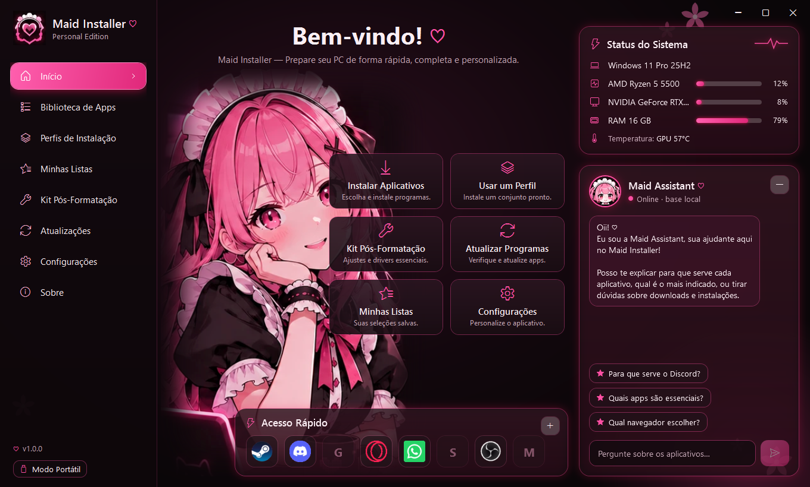
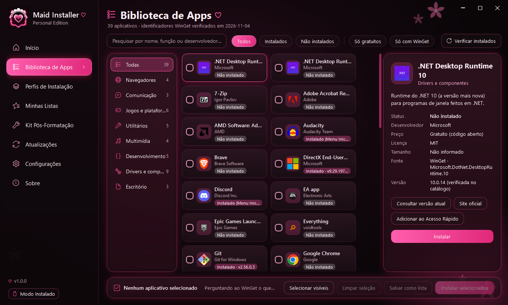
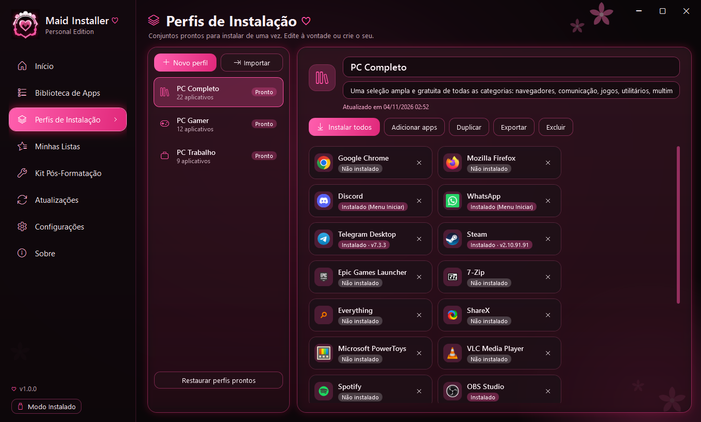

<div align="center">

# Maid Installer ♡

**Prepare seu PC com carinho.**

Instale, atualize e organize seus programas depois de formatar o Windows, num app com a mascote Maid, três temas
(escuro, claro e preto e rosa) e uma assistente que tira dúvidas. Em português (Brasil) e inglês.

**Português** · [English](README.en.md)

[](https://github.com/Maidzinha/maid-installer/releases/latest)


[](LICENSE)



</div>

## Baixar

Vá em **[Releases → última versão](https://github.com/Maidzinha/maid-installer/releases/latest)** e escolha um dos dois pacotes:

| Pacote | Quando usar |
|---|---|
| **`MaidInstaller-<versão>-portatil-win-x64.zip`** | Para levar num **pendrive / Ventoy** e usar logo depois de formatar. Não instala nada no PC |
| **`MaidInstaller-<versão>-win-x64.zip`** | Para deixar **instalado no PC**, com atalho no Menu Iniciar |

Os dois já trazem o .NET dentro, então abrem num Windows recém-formatado sem precisar instalar mais nada antes.

**Requisitos:** Windows 10 (versão 1809 ou mais nova) ou Windows 11, 64 bits. Para instalar programas é preciso o **WinGet**, que já vem no Windows 11 e nos Windows 10 atualizados. Se ele faltar, o app avisa e mostra onde conseguir.

## Como usar

### Opção 1: pendrive / Ventoy (portátil)

1. Baixe o `…-portatil-win-x64.zip` e extraia.
2. Copie a pasta **`MaidInstaller`** inteira para o pendrive. No Ventoy, ela pode ficar na raiz, ao lado das ISOs.
3. Depois de formatar o PC, abra **`MaidInstaller\MaidInstaller.exe`** direto do pendrive.

No modo portátil, tudo fica no pendrive: configurações, listas, perfis, logs e a IA.

### Opção 2: instalar no PC

1. Baixe o `…-win-x64.zip` e extraia **o arquivo inteiro**.
2. Dê dois cliques em **`Instalar.cmd`** e confirme.
3. Abra o **Maid Installer** pelo Menu Iniciar.

O instalador não pede administrador e não mexe no registro. As mensagens dele seguem o idioma do Windows. Para atualizar, rode o `Instalar.cmd` da versão nova: seus dados continuam. Para desinstalar, use o `Desinstalar.ps1` da pasta do programa (`%LocalAppData%\Programs\MaidInstaller`).

> **"O Windows protegeu o computador"?** Esse aviso do SmartScreen aparece porque o app não tem assinatura digital comercial.
> Clique em **Mais informações → Executar assim mesmo**. Para conferir o download, compare o SHA-256 do arquivo com o `SHA256SUMS.txt` da release.

### Primeiros passos

1. **Biblioteca de Apps:** procure os programas que quiser, marque e clique em **Instalar selecionados**. Antes de começar, aparece a lista exata para você confirmar.
2. Ou use um **Perfil** pronto (PC Gamer, PC Trabalho, PC Completo) com **Instalar todos**.
3. Rode as verificações do **Kit Pós-Formatação**: Windows Update, drivers, Visual C++ e DirectX, runtimes, temporários e energia.
4. Ficou com dúvida sobre algum programa? Pergunte à **Maid Assistant** ("Para que serve o 7-Zip?", "Qual navegador escolher?").
5. Quer outro visual ou idioma? **Configurações › Idioma e aparência**: Português (Brasil), English ou Automático, e o tema Escuro, Claro ou Preto e rosa.

> Numa instalação nova, o app abre em **inglês** e no tema **Escuro**. Para usar em português, escolha **Português (Brasil)** em
> Configurações › Idioma e aparência (ou **Automático**, que segue o idioma do Windows) e clique em **Aplicar e reabrir o app**.

O passo a passo de cada tela está no **[Manual de uso](docs/MANUAL.md)**.

<p align="center">
  
  
</p>

## O que ele faz

- **Biblioteca com 61 apps:** navegadores, comunicação, jogos, utilitários, multimídia, desenvolvimento, drivers e escritório. Todos com ID do WinGet conferido, pesquisa, filtros e status real de instalação.
- **Instalação organizada:** um programa por vez, mostrando a etapa real. Dá para cancelar, tentar de novo, ver o log de cada app e ler os erros explicados no seu idioma. Quando a fila termina com o app em segundo plano, um aviso do Windows mostra o resultado.
- **Perfis e listas:** use os prontos ou crie os seus, e exporte ou importe arquivos `.maidlist.json`.
- **Kit Pós-Formatação:** 10 verificações reais do sistema. As ações são opcionais e sempre pedem confirmação.
- **Atualizações:** mostra o que o WinGet encontrou e só atualiza o que você escolher.
- **Maid Assistant:** responde offline com uma base de conhecimento. A IA local (Qwen2.5 0.5B, cerca de 470 MB) é opcional, pode ser baixada pelo app em Configurações e fica limitada aos fatos da base.
- **Status do Sistema:** uso real de CPU, GPU e RAM e a temperatura da GPU, quando o PC permite.
- **Tour de boas-vindas:** na primeira abertura, a Maid apresenta as telas principais em poucos balões.
- **Dois idiomas e três temas:** português (Brasil) e inglês; Escuro (padrão), Claro e Preto e rosa.

## Segurança

- Tudo vem de **fontes oficiais**, pelo WinGet. O catálogo tem só dados, nunca comandos.
- **Nada é instalado ou atualizado sem a sua confirmação.** O app **nunca reinicia o PC**.
- O app não desativa o antivírus e não guarda senhas.
- A Maid Assistant **não executa, não instala e não remove nada**: ela só explica.

## Documentação

| | |
|---|---|
| [Instalação](docs/INSTALACAO.md) | Requisitos, portátil, instalar, atualizar, desinstalar, configuração padrão |
| [Manual de uso](docs/MANUAL.md) | Todas as telas, a Maid Assistant e problemas comuns |
| [Histórico de versões](CHANGELOG.md) | O que mudou em cada versão |
| [English documentation](README.en.md) | README, installation, manual and changelog in English (`docs/en`) |
| [Testes](docs/TESTES.md) | O que foi testado de verdade e as limitações conhecidas |
| [Arquitetura](docs/ARQUITETURA.md) · [Roadmap](docs/ROADMAP.md) · [Atualizações](docs/ATUALIZACOES.md) · [Ícones](docs/ICONES.md) | Documentação técnica |

## Licença

O Maid Installer é **proprietário**, sob uma [licença de uso privado](LICENSE). Todos os direitos são reservados.

- ✅ **Pode:** baixar daqui, instalar e usar de graça, em quantos PCs quiser, e indicar o link oficial.
- ❌ **Não pode:**
  - modificar o app ou criar versões derivadas dele;
  - apresentá-lo como obra sua;
  - redistribuir as cópias fora deste repositório;
  - vender;
  - usar o nome, a mascote ou o visual em outros projetos.

O código está visível só para consulta, o que não dá permissão para reutilizá-lo.
Os componentes de terceiros (.NET, LLamaSharp, llama.cpp…) continuam com as licenças deles: veja [THIRD-PARTY-NOTICES.md](THIRD-PARTY-NOTICES.md).

## Compilar a partir do código

Compilar é permitido só para uso pessoal, sem modificar o app (veja a [licença](LICENSE)). É preciso o [.NET SDK 10](https://dotnet.microsoft.com/download) no Windows.

```bash
git clone https://github.com/Maidzinha/maid-installer.git
```

```bash
cd maid-installer
```

```bash
dotnet run --project src/MaidInstaller.App
```

Para rodar os testes:

```bash
dotnet test
```

Para gerar os pacotes de entrega, o `build-release.ps1` roda os testes, publica em Release e cria os `.zip`, o `SHA256SUMS.txt` e o `release.json` em `dist\release`:

```bash
powershell -ExecutionPolicy Bypass -File .\build-release.ps1
```

<details>
<summary>Estrutura do projeto</summary>

| Caminho | O quê |
|---|---|
| `src/MaidInstaller.Core` | Lógica: WinGet, fila, catálogo, perfis, Kit, assistente, armazenamento, tradução (`Localization/L.cs`) |
| `src/MaidInstaller.AI` | IA local (llama.cpp via LLamaSharp) |
| `src/MaidInstaller.App` | Interface WPF, temas (`Themes/`), dicionário inglês (`Localization/en.json`), catálogo (`Catalog/`), configuração padrão (`Defaults/`), imagens (`Assets/`) |
| `tests/MaidInstaller.Core.Tests` | Testes xUnit (inclusive um que confere se todo texto tem tradução em inglês) |
| `installer/` | `Instalar.cmd`, `Instalar.ps1`, `Desinstalar.ps1` |
| `docs/` | Documentação (`docs/en` em inglês) |

</details>

---

<div align="center"><sub>Maid Installer — Personal Edition · © 2026 Helder (Maidzinha) · todos os direitos reservados ♡</sub></div>
